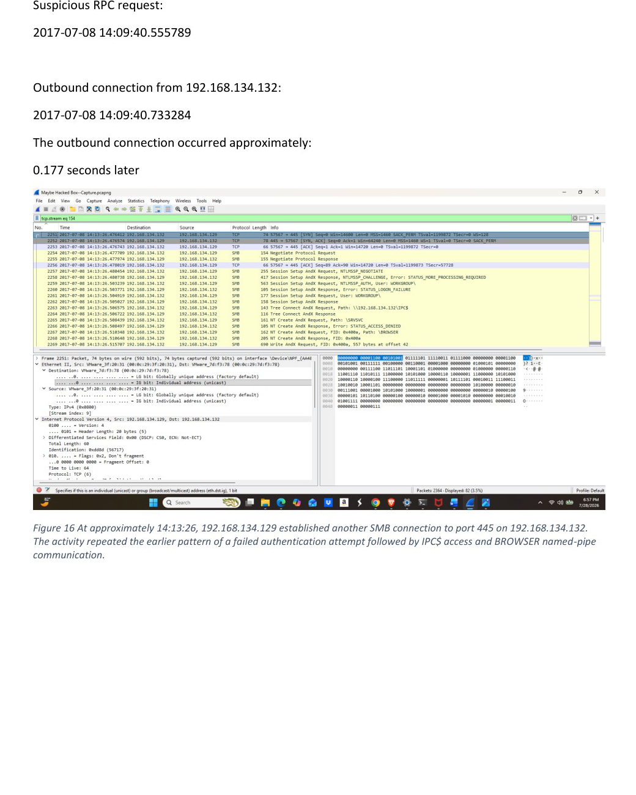

# Attack Analysis & Incident Reconstruction

Wireshark and Windows event-log investigation reconstructing anonymous SMB/RPC activity, a rapid victim callback, and delivery of a Windows PE object.

**Author:** [Tenny Wu](https://github.com/714tenny)  
**Project type:** Academic lab / historical case study  
**Status:** Source work documented; scope and validation limits recorded below

## Context

Completed academic report dated July 28, 2026, examining supplied packet and event-log evidence from July 8, 2017. Findings come from the completed report and its screenshots, not the assignment sheet.

## Tools

Wireshark, Windows Event Viewer, PowerShell

## Key results

- Reconstructed SMB TCP/445 activity, a successful null session, IPC$ access, and BROWSER named-pipe RPC.
- Correlated a suspicious RPC call with a victim-initiated callback approximately 0.177 seconds later.
- Identified approximately 1.63 MB of PE-containing transfer data, exported one direction of TCP stream 1 without execution, and recorded its SHA-256.
- Distinguished confirmed packet observations from probable exploitation and unconfirmed payload execution, persistence, or exfiltration.

## Documentation

- [Investigation notes](docs/investigation.md)
- [Sources and screenshot index](docs/source-and-evidence.md)
- [Commands](docs/commands.md)
- [Timeline](docs/timeline.md)
- [Recorded indicators](indicators/observations.csv)

## Evidence preview

See the [evidence index](docs/source-and-evidence.md) for source-page references and the limits of each observation.

## Skills demonstrated

Packet analysis, SMB/DCE-RPC interpretation, TCP reassembly, artifact preservation, hash documentation, event-log review, chronological reconstruction.

## Evidence boundaries

This repository presents authorized coursework and its recorded evidence. It does not represent a live production incident, newly validated remediation, or a deployed security product. Conclusions, uncertainties, and source discrepancies are documented in the investigation notes.
